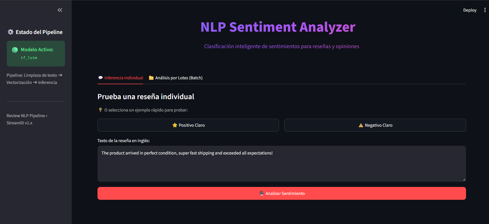
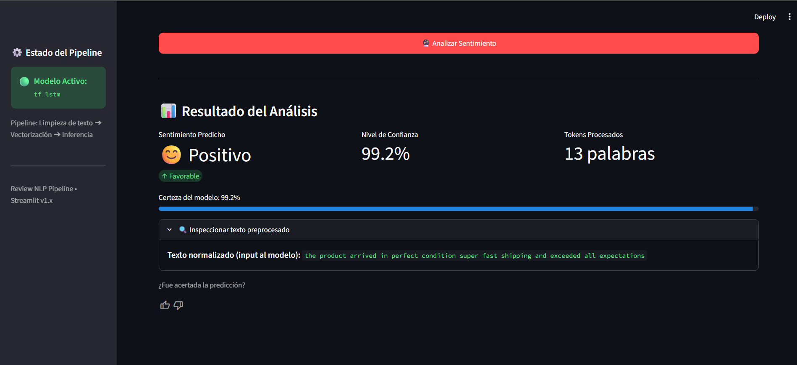

# NLP Sentiment Analyzer

Sistema de análisis de sentimiento para reseñas de productos de Amazon, desarrollado con técnicas de Procesamiento de Lenguaje Natural (NLP), Machine Learning y Deep Learning. El proyecto entrena y compara modelos de clasificación, seleccionando la mejor arquitectura para su puesta en producción y despliegue interactivo mediante una interfaz web construida con **Streamlit**, empaquetada con **Docker** y lista para **GitHub Codespaces**.

Este es un proyecto de carácter académico con propósitos educativos y de experimentación en pipelines de NLP extremo a extremo.

---

## 1. Problemática

Los comercios electrónicos reciben diariamente grandes volúmenes de reseñas de clientes. Analizar esta información de forma manual resulta ineficiente y dificulta detectar con agilidad el nivel de satisfacción de los usuarios, incidencias recurrentes en los productos y patrones de opinión clave.

Esta solución está orientada a:

- Marketplaces y plataformas de comercio electrónico.
- Marcas y vendedores en canales digitales.
- Equipos de experiencia del cliente (CX) y soporte.
- Product Managers y analistas de producto.

---

## 2. Solución Propuesta

El proyecto implementa un pipeline integral para clasificar automáticamente reseñas en inglés como **positivas** o **negativas**:

1. **Exploración del dataset (EDA):** Análisis de distribución, longitudes de texto y n-gramas frecuentes.
2. **Limpieza y preprocesamiento:** Normalización textual, remoción de etiquetas HTML/URLs y filtrado adaptativo de stopwords.
3. **Vectorización:** Extracción de matrices TF-IDF para modelos de boosting y generación de secuencias numéricas con embeddings para redes neuronales.
4. **Modelado y optimización:** Entrenamiento de modelos y optimización bayesiana de hiperparámetros con Optuna.
5. **Evaluación y selección:** Comparación rigurosa sobre conjunto de prueba en múltiples métricas de clasificación.
6. **Despliegue y UI interactiva:** Aplicación web moderna con Streamlit para inferencia individual y análisis masivo por lotes.
7. **Contenerización:** Entorno reproducible con Docker y GitHub Codespaces mediante Dev Containers.

<table>
  <tr>
    <td valign="top">
      
    </td>
    <td valign="top">
      
    </td>
  </tr>
</table>

---

## 3. Dataset

Se utilizó el dataset [Amazon Reviews for Sentiment Analysis](https://www.kaggle.com/datasets/bittlingmayer/amazonreviews) de Kaggle (`bittlingmayer/amazonreviews`).

El dataset original contiene aproximadamente 3.6 millones de reseñas en formato FastText comprimido. Para garantizar reproducibilidad y eficiencia en el entrenamiento, se trabajó con una muestra estratificada representativa:

| Conjunto                            |   Registros |
| :---------------------------------- | ----------: |
| Datos originales para entrenamiento |     120,000 |
| Datos originales para prueba        |      24,000 |
| **Entrenamiento final**             | **102,000** |
| **Validación**                      |  **18,000** |
| **Prueba final**                    |  **24,000** |

Interpretación de etiquetas:
- `0`: Sentimiento negativo.
- `1`: Sentimiento positivo.

---

## 4. Exploratory Data Analysis (EDA)

En `notebooks/1_EDA.ipynb` se evaluó la calidad de los datos, evidenciando un balance adecuado entre clases:
- **Reseñas positivas:** `51.27%`
- **Reseñas negativas:** `48.73%`

El flujo descomprime y estructura los archivos `.bz2`, consolidando los datos en `data/raw/` para su posterior procesamiento.

---

## 5. Limpieza y Preprocesamiento

La función modular `clean_text()` implementada en `src/preprocessing.py` ejecuta:
- Conversión a minúsculas.
- Eliminación de etiquetas HTML, URLs, signos de puntuación y caracteres especiales.
- Normalización de espacios en blanco.
- **Filtrado selectivo de stopwords (`model_rn`):**
  - Para modelos basados en árboles y TF-IDF (`model_rn=False`): se eliminan las stopwords para reducir la dimensionalidad de la matriz dispersa.
  - Para redes neuronales recurrentes (`model_rn=True`): se conservan las stopwords para mantener la cohesión sintáctica y el contexto secuencial de la frase.

Los datos procesados se exportan de forma estratificada a `data/processed/`.

---

## 6. Vectorización y Representación Textual

| Modelo      | Enfoque de Representación                | Configuración                                                               |
| :---------- | :--------------------------------------- | :-------------------------------------------------------------------------- |
| **XGBoost** | TF-IDF (Unigramas + Bigramas)            | Máximo 5,000 características léxicas                                        |
| **LSTM**    | Secuencias de tokens + Capa de Embedding | Vocabulario de 11,000 tokens, longitud fija de 100 pasos (`padding='post'`) |

---

## 7. Modelos Evaluados

En el notebook de modelado y evaluación (`notebooks/3_Modeling_Evaluation.ipynb`) se entrenan y comparan dos arquitecturas representativas:

### 1. XGBoost (Extreme Gradient Boosting)
* Modelo basado en árboles de decisión sobre matrices dispersas TF-IDF.
* Hiperparámetros optimizados mediante búsqueda bayesiana con **Optuna** (optimizando número de estimadores, profundidad máxima y tasa de aprendizaje con podado de ramas por AUC).

### 2. LSTM (Long Short-Term Memory Neural Network)
* Red neuronal recurrente construida en TensorFlow/Keras.
* Arquitectura compuesta por:
  - Capa `Embedding` con enmascaramiento de ceros (`mask_zero=True`).
  - 3 capas recurrentes `LSTM` apiladas (64 unidades cada una) con regularización y retorno de secuencias.
  - Capas densas intermedias con activaciones `relu` y regularizadores de dropout.
  - Capa de salida con activación `sigmoid` para estimar la probabilidad posterior del sentimiento.
* Entrenamiento con optimizador `rmsprop`, función de pérdida `binary_crossentropy` y callback de `EarlyStopping` restaurando los mejores pesos según `val_loss`.

---

## 8. Resultados de Evaluación en Test

Ambos modelos fueron evaluados sobre el conjunto de prueba independiente (24,000 reseñas nunca vistas durante el entrenamiento):

| Modelo      |  Accuracy  | Precision (1) | Recall (1) | F1-Score (1) | Precision (0) | Recall (0) | F1-Score (0) |  ROC-AUC   |
| :---------- | :--------: | :-----------: | :--------: | :----------: | :-----------: | :--------: | :----------: | :--------: |
| **XGBoost** |   0.8758   |    0.8738     |   0.8861   |    0.8799    |    0.8781     |   0.8650   |    0.8715    |   0.9476   |
| **LSTM**    | **0.9143** |  **0.9126**   | **0.9213** |  **0.9169**  |  **0.9161**   | **0.9070** |  **0.9115**  | **0.9684** |

---

## 9. Selección del Modelo Final

El modelo **LSTM** superó de manera contundente a XGBoost en todas las métricas de evaluación:
- **Accuracy global:** `91.43%` (frente a 87.58% de XGBoost).
- **F1-Score balanceado:** `0.9169` para la clase positiva y `0.9115` para la clase negativa.
- **Capacidad discriminatoria:** ROC-AUC de `0.9684`.

Por consiguiente, el modelo LSTM fue exportado a `models/` junto a sus artefactos de producción:
```text
models/
├── best_model.keras   # Red neuronal entrenada con los mejores pesos
├── model_type.pkl     # Identificador de tipo de modelo ("tf_lstm")
└── vocab.pkl          # Mapeo de tokens a índices numéricos
```

---

## 10. Interfaz Web con Streamlit

La aplicación se encuentra en `app/main.py` y fue diseñada con un enfoque orientado a la experiencia de usuario (UX) y valor de negocio:

### Inferencia Individual
- **Entrada ágil en 1 clic:** Botones de prueba rápida (`⭐ Positivo Claro` y `⚠️ Negativo Claro`) que autocompletan ejemplos sin necesidad de redactar reseñas manualmente.
- **KPIs ejecutivos (`st.metric`):** Métricas destacadas con deltas visuales automáticos (Sentimiento predicho, Porcentaje de certeza y Cantidad de tokens procesados).
- **Barra de confianza dinámica:** Visualizador del nivel de certidumbre del modelo.
- **Transparencia y explicabilidad:** Sección desplegable para auditar el texto limpio tras el preprocesamiento.
- **Retroalimentación continua:** Componente nativo de feedback (`thumbs up/down`) para simular recolección de casos de aprendizaje activo.

### Análisis Masivo por Lotes (Batch)
- **Soporte multiformato:** Carga directa de archivos `.csv`, hojas de cálculo de Excel (`.xlsx`, `.xls`) o archivos de texto plano (`.txt` línea por línea).
- **Detección inteligente:** Mapeo automático de columnas que contengan nombres como `review`, `text`, `comentario` u `opinion`.
- **Procesamiento con barra de avance en tiempo real:** Feedback continuo del progreso de inferencia.
- **Gráfico de distribución (Altair):** Gráfico de barras interactivo con paleta semántica (verde/rojo) que visualiza tanto el **recuento absoluto** como el **porcentaje relativo** de cada sentimiento sobre las barras.
- **Exportación de reportes:** Botón de descarga con el dataset procesado y enriquecido con columnas de predicción y nivel de confianza.

### ⚙️ Consideraciones Técnicas de la UI (`.streamlit/config.toml`)
Para garantizar un comportamiento estable en entornos en la nube (como GitHub Codespaces) y evitar prompts innecesarios en contenedores:
```toml
[server]
port = 8501
address = "0.0.0.0"
headless = true
enableCORS = false
enableXsrfProtection = false

[browser]
gatherUsageStats = false
```

---

## 11. Despliegue con Docker y GitHub Codespaces

### Imagen Docker Optimizada
El [Dockerfile](Dockerfile) utiliza `python:3.11-slim` e integra variables de entorno para silenciar logs superfluos y optimizar la salida:
- `PYTHONDONTWRITEBYTECODE=1` y `PYTHONUNBUFFERED=1`
- `TF_ENABLE_ONEDNN_OPTS=0` y `TF_CPP_MIN_LOG_LEVEL=2`
- Healthcheck nativo consultando el endpoint interno de Streamlit: `/_stcore/health`.

### Configuración para GitHub Codespaces (`.devcontainer`)
El proyecto está preconfigurado para abrirse en un solo clic dentro de GitHub Codespaces:
- `.devcontainer/docker-compose.yml`: Define el servicio montando el workspace local con cache.
- `.devcontainer/devcontainer.json`: Reenvía y etiqueta automáticamente el puerto `8501` bajo el nombre *Streamlit App*.

---

## 12. Instrucciones de Ejecución

### Opción A: Ejecución Local

1. Crear y activar un entorno virtual:
   ```bash
   python -m venv .venv
   source .venv/bin/activate    # En Linux/macOS
   .venv\Scripts\activate       # En Windows
   ```

2. Instalar dependencias:
   ```bash
   pip install -r requirements.txt
   ```

3. Ejecutar la aplicación:
   ```bash
   streamlit run app/main.py
   ```
   Acceder desde el navegador a `http://localhost:8501`.

---

### Opción B: Ejecución con Docker

1. **Construir la imagen:**
   ```bash
   docker build -t nlp-sentiment-analyzer .
   ```

2. **Ejecutar el contenedor:**
   ```bash
   docker run --rm -p 8501:8501 nlp-sentiment-analyzer
   ```

---

### Opción C: Ejecución con Docker Compose

```bash
docker compose -f .devcontainer/docker-compose.yml up --build
```

---

## 13. Estructura del Repositorio

```text
review-nlp-pipeline/
├── .devcontainer/
│   ├── devcontainer.json         # Configuración de entorno y puertos para Codespaces
│   └── docker-compose.yml        # Orquestación del servicio contenedorizado
├── .streamlit/
│   └── config.toml               # Configuración del servidor y desactivación de telemetría
├── app/
│   └── main.py                   # Aplicación interactiva de Streamlit (Individual + Batch)
├── src/
│   ├── models.py                 # Arquitecturas de modelos (LSTM, TextCNN)
│   ├── predict.py                # Clase SentimentPredictor para inferencia en producción
│   └── preprocessing.py          # Pipeline de limpieza y normalización textual
├── notebooks/
│   ├── 1_EDA.ipynb               # Análisis exploratorio de datos y balance de clases
│   ├── 2_Preprocessing_Cleaning.ipynb # Generación de datasets limpios y vocabulario
│   └── 3_Modeling_Evaluation.ipynb    # Entrenamiento, optimización y evaluación (XGBoost y LSTM)
├── data/
│   ├── raw/                      # Datos crudos extraídos de Amazon Reviews
│   └── processed/                # Splits limpios (train, val, test)
├── models/
│   ├── best_model.keras          # Modelo final LSTM guardado
│   ├── model_type.pkl            # Metadatos del modelo activo
│   ├── vocab.pkl                 # Vocabulario de embeddings
│   └── vectorizer.pkl            # Vectorizador TF-IDF
├── Dockerfile                    # Definición de la imagen del contenedor
├── requirements.txt              # Dependencias fijadas del proyecto
└── README.md                     # Documentación general del proyecto
```
